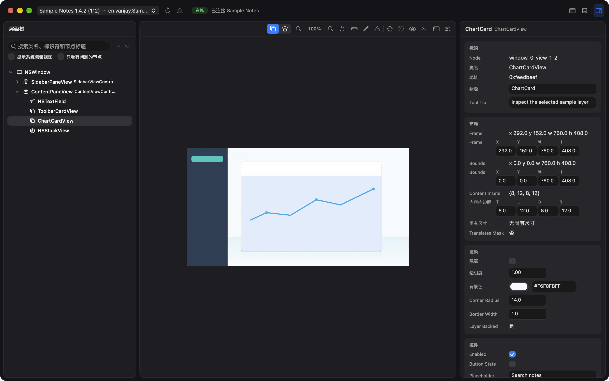
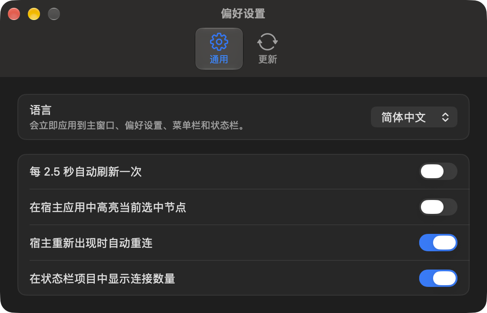

# ViewScope

ViewScope 是一个面向原生 macOS / iOS 开发的 UI 调试工具，可以检查 AppKit 与 UIKit 应用（macOS、iOS 模拟器、USB 连接的 iOS 真机），提供类似 Lookin / Reveal 的实时层级查看、属性检查、截图预览、节点高亮，并补充了测量、布局诊断、修改记录与快照对比等它们没有的能力。集成成本低，数据只在本机（或经 USB）流动。

## 特性

- 原生 AppKit 客户端，包含主窗口、状态栏入口、偏好设置、文件导入导出与 Sparkle 更新检查
- 宿主平台：macOS（AppKit）、iOS / iPadOS 模拟器、USB / Wi‑Fi 配对的 iOS 真机（UIKit）
  - macOS 宿主通过 `DistributedNotificationCenter` 广播并监听 `127.0.0.1:47300...47339` 端口段
  - iOS 模拟器与 Mac 共享 loopback，客户端扫描同一端口段即可发现
  - iOS 真机通过 `usbmuxd` 隧道连接，设备端无需额外配置
- 每个连接独立 token 认证，请求带超时，宿主断开后保留最后一次抓取并在宿主重新出现时自动重连
- 左侧层级树：搜索（自动展开命中路径、匹配计数、上一个/下一个）、Focus 子树、隐藏节点、事件 handler 详情、布局问题徽标
- 中间 2D / 3D 预览：以光标为锚点缩放、支点正确的旋转、复位视角、尊重裁剪、悬停与层级树双向联动、键盘快捷键
- 右侧 Inspector：文本、数值、开关、枚举下拉、四边值、颜色等属性直接修改并回写宿主，layer-backed 视图的视图级属性与约束完整可用
- 调试控制台：支持带参数方法（`setHidden:YES`、`setFrame:{0,0,100,40}`）、key path、`@0x…` 对象引用、历史记录与自动补全
- 支持导入和导出 `.viewscope` 捕获文件，便于离线查看与共享
- 支持中英文界面、本地偏好持久化，以及通过 GRDB 记录最近连接宿主与捕获耗时

### Reveal / Lookin 没有的能力

- **测量与取色**：开启测量（或按住 Option）后显示参照节点与悬停节点之间的间距；左下角显示光标坐标；取色器按宿主原始像素取色并一键复制 hex
- **布局问题诊断**：自动标记歧义布局、被祖先裁剪、完全越界、零尺寸容器、非整像素 frame、透明却拦截事件、被不透明兄弟完全遮挡、文本截断、图片放大模糊、过小点击区域（iOS）、层级过深；在层级树、预览描边和诊断列表中展示
- **修改记录**：记录每一次实时修改，支持 ⌘Z / ⇧⌘Z 撤销重做、逐条还原，并按 AppKit / UIKit 导出为 Swift 代码
- **抓取对比**：把某次抓取（或 `.viewscope` 文件）设为基线，与当前抓取做层级 diff：新增、删除、位置/尺寸变化、显隐/透明度变化、类变化、父节点变化

## 截图

<p>
  
</p>
<p>
  
</p>

## 项目结构

- `ViewScope/`: 主应用工程，使用 SnapKit、GRDB、Sparkle 和本地 `ViewScopeServer` 包
- `ViewScopeServer/`: 宿主侧运行时，包含源码、CocoaPods podspec、Carthage framework 工程
- `Package.swift`: 仓库根目录的 SwiftPM 入口，对外暴露 `ViewScopeServer`
- `READMEAssets/`: README 截图资源，由测试自动生成
- `ViewScope/ViewScopeTests/`: 主应用测试，覆盖界面状态、预览渲染和交互回归

## 本地开发

要求：

- macOS 12.0+
- Xcode（当前仓库已在本机 Xcode 17C529 环境完成构建与测试）

日常开发建议直接打开 `ViewScope/ViewScope.xcodeproj`。若只验证宿主侧库，也可以直接使用根目录 `Package.swift` 或 `ViewScopeServer/Package.swift`。

常用命令：

```bash
xcodebuild \
  -project ViewScope/ViewScope.xcodeproj \
  -scheme ViewScope \
  -destination 'platform=macOS' \
  test

swift test
swift test --package-path ViewScopeServer

xcodebuild \
  -project ViewScopeServer/ViewScopeServer.xcodeproj \
  -scheme ViewScopeServer \
  -destination 'generic/platform=macOS' \
  build CODE_SIGNING_ALLOWED=NO
```

## 集成 ViewScopeServer

### Swift Package Manager

```swift
.package(url: "https://github.com/wangwanjie/ViewScope.git", from: "1.2.2")
```

仓库根目录直接提供 `Package.swift`，Xcode / SwiftPM 可以直接依赖整个仓库 URL，无需指向 `ViewScopeServer/` 子目录。

把 `ViewScopeServer` product 加到 Debug 宿主 target：

```swift
import ViewScopeServer
```

默认情况下，只要库被加载到 Debug 构建中，`ViewScopeServer` 会在宿主应用完成启动后自动启用。

如果你想自己控制启用时机，可以在很早期先关闭自动启用，再在合适的时机手动调用 `start()`：

```swift
import ViewScopeServer

@main
struct DemoApp: App {
    init() {
        ViewScopeInspector.disableAutomaticStart()
    }

    var body: some Scene {
        WindowGroup {
            ContentView()
                .task {
                    ViewScopeInspector.start()
                }
        }
    }
}
```

如果你的 macOS Debug 宿主启用了 `App Sandbox`，请先把 Debug 配置里的 `ENABLE_APP_SANDBOX` 关掉。当前发现层使用 `DistributedNotificationCenter`，而系统默认的 app sandbox 不允许普通应用发送这类 discovery 广播，所以客户端会一直看不到 `Live Hosts`。

### iOS 宿主

iOS 与 macOS 共用同一个 `ViewScopeServer` product（iOS 13+；用 Xcode 27 构建时需要把 iOS 部署目标设为 15.0）。把它加到 iOS App 的 Debug target 即可，启动完成后自动开启：

- iOS 模拟器：直接运行，ViewScope 会在 `Live Hosts` 中列出
- iOS 真机：用 USB 连接（或已开启 Wi‑Fi 同步配对）并让 App 保持在前台，ViewScope 通过 usbmuxd 自动发现

### CocoaPods

```ruby
pod 'ViewScopeServer', :git => 'https://github.com/wangwanjie/ViewScope.git', :tag => 'v1.2.2', :configurations => ['Debug']
或者
pod 'ViewScopeServer', :git => 'https://github.com/wangwanjie/ViewScope.git', :branch => 'main', :configurations => ['Debug']
```

### Carthage

```ruby
github "wangwanjie/ViewScope" ~> 1.2
```

然后执行：

```bash
carthage update --use-xcframeworks --platform macOS
```

将生成的 `ViewScopeServer.framework` 链接到 Debug 宿主即可；默认会在启动完成后自动启用。

## 使用方式

1. 启动 ViewScope。
2. 运行已集成 `ViewScopeServer` 的 Debug 宿主应用（macOS、iOS 模拟器或 USB 连接的 iOS 真机）。
3. 在工具栏或左侧 `Live Hosts` 里选择宿主，ViewScope 会通过 loopback 建立连接。
4. 在层级树中搜索或选中节点，主预览区可切换 2D / 3D，并支持缩放、聚焦、显隐和高亮。
5. 右侧 Inspector 会显示属性、约束与布局信息；支持的字段可以直接修改并回写宿主。
6. 需要时可打开控制台执行表达式，或通过菜单导入 / 导出 `.viewscope` 捕获文件。

## 状态栏设计

ViewScope 会常驻一个 `VS` 状态栏入口：

- 实时显示当前是否已连接宿主，并可选展示连接计数
- 直接打开主窗口、刷新当前捕获、开关自动刷新和自动高亮
- 展示最近发现的本机宿主列表，便于快速连接
- 提供偏好设置、检查更新和退出入口

## 偏好设置

当前偏好设置主要包含两组：

- 通用：界面语言、自动刷新、自动高亮、状态栏连接计数
- 更新：检查更新策略、自动下载更新、手动检查更新与 GitHub 主页入口

## 安全与性能

- 发现和采集数据默认只在本机传输，不依赖远端服务
- 宿主监听地址固定在 `127.0.0.1`（iOS 真机仅可经 usbmuxd 访问），每个连接都必须使用一次性 token 完成握手后才能抓取或修改
- 默认只建议在 Debug 构建里启用 `ViewScopeServer`
- 对于 sandboxed 的 macOS 宿主，建议专门准备一个关闭 `App Sandbox` 的 Debug 配置
- 捕获历史限制为最近 250 条，避免数据库持续膨胀
